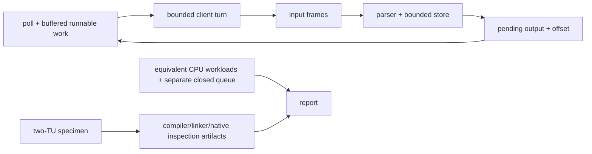

# C++ systems tools

Two small C++20/POSIX developer tools: a bounded TCP key-value service and a bundled-specimen runtime/performance inspector. No external runtime services or third-party C++ dependencies.

## Features

- **[TCP KV](projects/tcp-kv/README.md):** persistent ASCII protocol, one nonblocking `poll` owner, bounded store/connections/buffers and fair turn budgets.
- **[Runtime Inspector](projects/runtime-inspector/README.md):** actual build/link/load artifacts, layout/memory observations, equivalent CPU workloads and a separate bounded mutex/CV queue.
- CTest tests with release-enabled checks; separate sanitizer presets; raw reproducible evidence rather than a promised speedup.

## Quick start

Requirements: C++20 compiler, CMake 3.25+, Ninja, Python 3.10+, POSIX (Linux reference, macOS development).

```sh
cmake --preset dev
cmake --build --preset dev
ctest --preset dev --output-on-failure
./build/dev/projects/tcp-kv/tcp-kv --port 5555
```

Protocol example (the first line is server stdout, replies are TCP payload):

```text
READY 5555
SET fruit green apple  -> OK
GET fruit             -> VALUE green apple
DEL fruit             -> DELETED
GET fruit             -> NOT_FOUND
```

Run the inspector from the same repository root:

```sh
python3 projects/runtime-inspector/report.py --output reports/runtime
./build/dev/projects/runtime-inspector/runtime-workloads --size 200000 --threads 4 --seed 42 --repetitions 7
```

Open `reports/runtime/report.md` for native artifacts and observations. See its [quick start](projects/runtime-inspector/README.md) for details. Reports are generated locally under `reports/` and are not source inputs.

## Architecture



The server never shares its map with workers. The queue belongs only to the inspector. Native artifacts, language guarantees and explanatory models are explicitly distinguished.

## Tests and results

`python3 scripts/verify.py` runs configure/build/CTest for dev, release, ASan, UBSan and a concurrency-only TSan preset. Failed builds mark tests **not run**. Raw commands, exits, source file hashes and platform are retained in `evidence/verification.json`. Capability probes: `python3 scripts/capabilities.py`. See [verification](docs/VERIFICATION.md) and the [ledger](progress.md) for actual results, not just supported commands.

**Verified release:** macOS ARM64/Clang 21 and Ubuntu x86-64/GCC 13.3 passed **7/7** tests per dev/release/ASan/UBSan preset and **3/3** concurrency tests under TSan. [Exact revisions, CI run, measurements and limitations](docs/RESULTS.md).

Measurements use release builds separately from sanitizer checks. `scripts/investigate_server.py` retains intended issue, actual issue and completion samples; client round-trip latency is not server service time. The inspector retains workload checksums and raw repetitions. See [investigations](docs/INVESTIGATIONS.md).

## Limitations

No persistence, authentication, Internet-facing hardening, arbitrary-process debugger or production profiler. Linux tools (`perf`, `strace`, ELF inspection) are not interchangeable with native macOS Mach-O tools. No physical frame claim follows from a virtual pointer. Hardware-counter availability and debugger authorization are reported, not assumed. `PGM` is unresolved. A [Linux route](docs/VERIFICATION.md) is documented; unrun checks are not passes. There are no learner records or private workbook answers in this repository.
