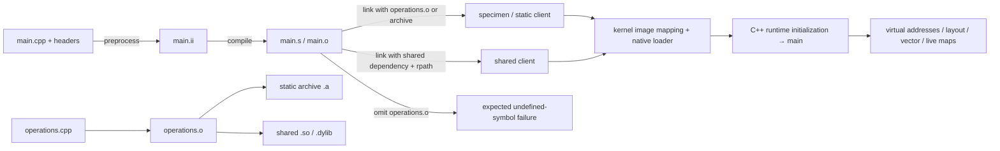
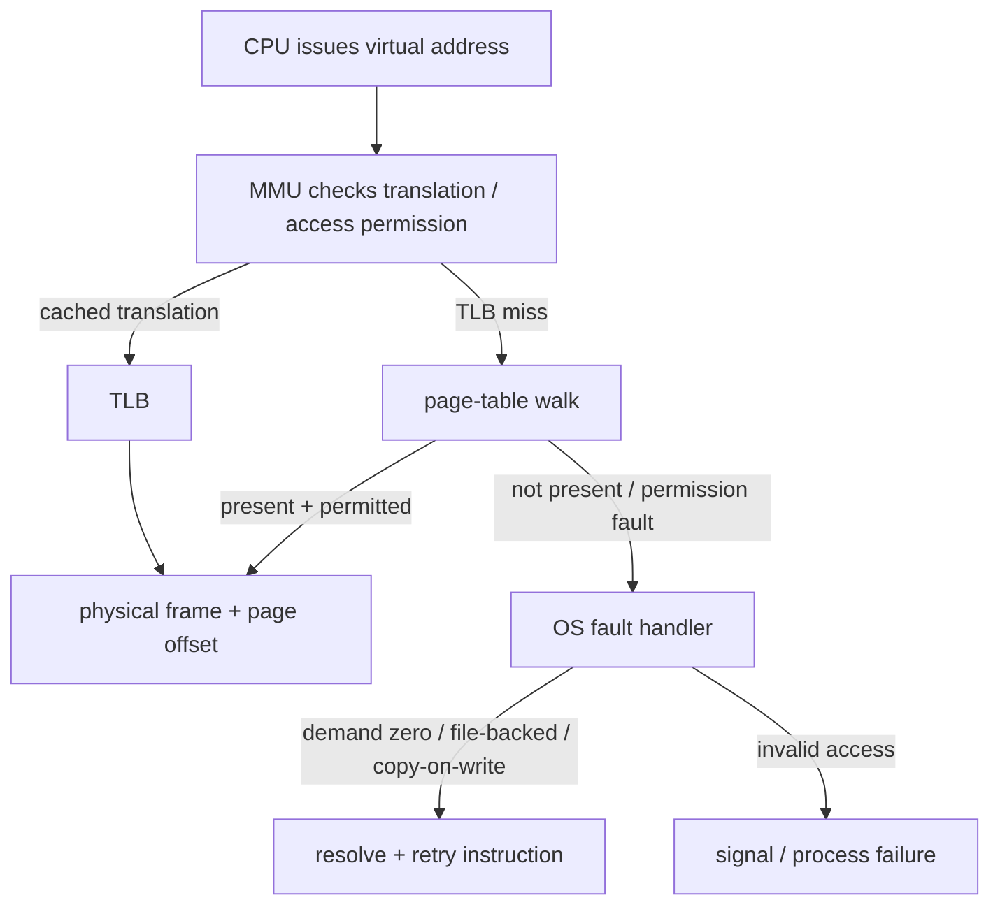
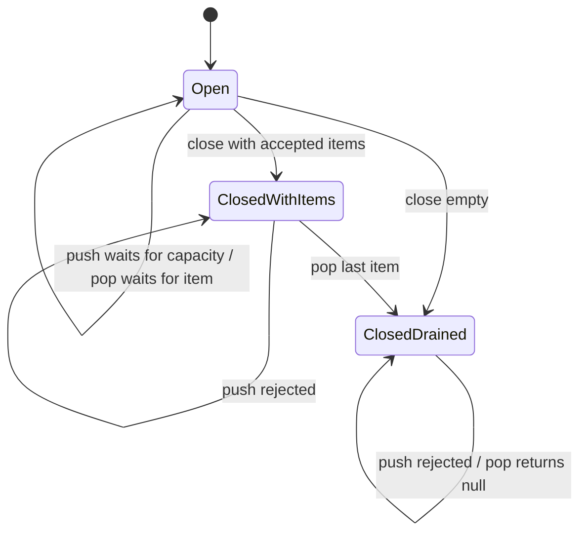

# Build, memory and concurrency architecture

Preprocessing includes headers and expands macros; compiler assembly still contains symbolic references. An object has relocations where addresses are unresolved. The linker resolves definitions, selects needed archive members and lays out the final image. Dynamic imports may need loader binding/fixups. Static archive use does **not** mean an entirely statically linked process: libc/C++ runtime may remain shared dependencies.

On **ELF/Linux**, sections (code/data/symbol/debug organization) are not loadable segments. Program headers (`PT_LOAD`, interpreter, etc.) drive page mapping/permissions; several sections can share one segment, and debug/symbol sections need not be mapped. On **Mach-O/macOS**, `LC_SEGMENT_64` and contained sections plus dylib load commands describe a different native format; `dyld` handles dependencies and fixups. The kernel and loader establish a process before C++ runtime static initialization and `main`; `main` is not the executable's first instruction. `otool -l` output is never labeled ELF.

This is a model, not a trace of this machine's MMU. `translator-model.json` explicitly invents one page-table entry. A TLB caches translations/permissions, not application objects; a TLB miss is not automatically a page fault. Page size is a platform parameter (the toy uses 4096 bytes regardless of the native page size). Virtual pages need not be contiguous physical frames. Maps show virtual regions, backing and access permissions, not physical RAM residency; resident memory differs from mapped virtual size.

Historical segmentation combines selector/base/limit concepts; it is distinct from modern page/frame translation. ELF segments and Mach-O segments are image-mapping structures, not a claim about historical x86 segment registers. Most modern user-space address observations are about paged virtual memory. MMU/TLB and platform-specific faults are not measured by merely printing pointers.

Ordinary faults happen during demand-zero first touch, bringing in file-backed pages, or copy-on-write. A minor fault can be resolved without backing-store I/O; major faults require I/O (native accounting differs). `getrusage` counters are cumulative since process startup, not a line-by-line fault cause. Permission checks distinguish writable/readable/executable mappings. Writing a shared private COW page can trigger creation of a private copy; other processes retain their view. COW is not C++ object copying, and a virtual-address equality across processes does not prove shared physical storage. No deliberate protection violation is run by this tool or its sanitizer tests.

Queue invariant under one mutex: `0 <= size <= capacity`; `closed` never returns to false. `not_full` predicate is `closed || size < capacity`, `not_empty` is `closed || !empty`. Closure notifies **all** waiters on both CVs; accepted items stay drainable. The owner closes, joins producers/consumers, then destroys the queue. A CV wakeup by itself is not permission to proceed: predicates handle spurious wakeups. Waiter counters are observational diagnostics under the same mutex, not busy-wait production synchronization. Tests use bounded yielding only to establish that a waiter really reached the blocked state before testing closure.

Workloads are independent of this queue and of the TCP server. Barriers delimit the timed interval; each local hot-loop sum stays in a private scalar and is published once to a spaced atomic slot with release/store and acquire/load. This makes publication explicit independently of the library barrier implementation. Shared/adjacent/spaced atomic increments use defined relaxed ordering; their timing differences alone cannot distinguish cache effects, instruction count, frequency, scheduler placement or contention. No forced optimization claim is made.

Windows PE/DLL is a documented analogous pipeline only. `PGM` remains unresolved.
