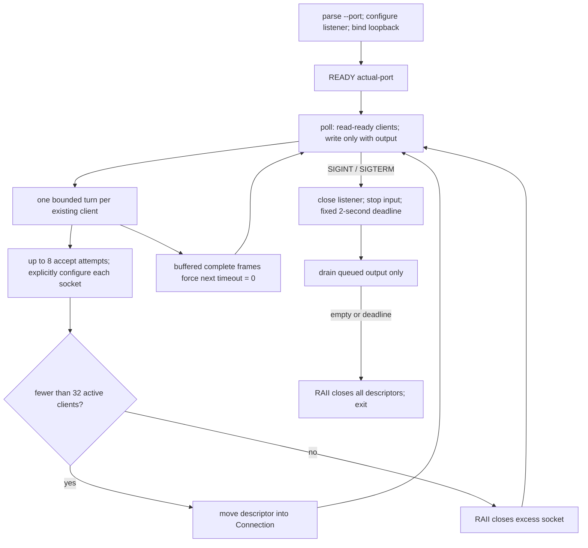

# Single-owner reactor

```mermaid
stateDiagram-v2
    [*] --> Open
    Open --> Open: recv partial / parse complete frames / send partial
    Open --> DiscardLine: 4096 bytes without LF; one length error
    DiscardLine --> DiscardLine: discard bounded received chunks
    DiscardLine --> Open: LF found; preserve suffix
    Open --> EOFProcessing: recv returns zero; deadline = now + 2s
    DiscardLine --> EOFProcessing: recv returns zero; no duplicate tail error
    EOFProcessing --> EOFProcessing: finish complete buffered frames then tail error
    EOFProcessing --> Draining: no unconsumed input
    Open --> Draining: signal; discard input; deadline = now + 2s
    DiscardLine --> Draining: signal; discard input
    EOFProcessing --> Draining: signal; retain earlier deadline
    Draining --> Closed: output empty or absolute deadline
    EOFProcessing --> Closed: absolute deadline
    Open --> Closed: fatal error / input or output overflow
    DiscardLine --> Closed: fatal error / input or output overflow
    Closed --> [*]
```

`main.cpp` owns listener, connections, store and transport on one thread. Signal
handlers set only a `sig_atomic_t` flag. `Connection` owns one move-only `Fd` and
holds input, unsent output offset, overlong-line discard state, EOF/shutdown state
and an optional absolute `steady_clock` deadline. A 25-ms maximum poll timeout
also checks the signal flag if a signal arrives just before poll; nearer drain
deadlines shorten that timeout. Socket setup/teardown is never delegated to workers.

One turn first processes buffered frames, then bounded receives and parsing,
then bounded sends when writable. All paths share the 16-command / 32-I/O-attempt
budget and separate 16-KiB receive/send limits. Parsing erases consumed prefixes;
output compaction removes only bytes confirmed sent. Input overflow is detected
using a receive of at most available room plus one detection byte. Neither buffer
admits bytes beyond its logical bound. A fixed 4-KiB receive scratch array is not
retained unconsumed input. `Transport` injection tests I/O outcomes without relying
on kernel packetization or incidental localhost short writes. Tests inject time
points rather than sleeping to prove the exact two-second boundary.

`parse(frame)` has no side effects. Its validated `Request` feeds `Store::execute`,
which returns an LF-terminated reply. The bounded map is never shared across threads.
The protocol and recovery precedence are defined in the [README](../README.md).
